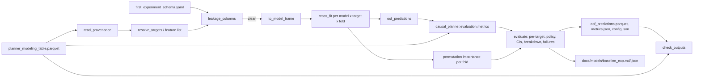

# Design Document: Classical Baseline

## Overview

`tools/train_baseline.py` fits interpretable baselines that predict each non-IDM planner's per-scenario effect `delta_<token>_vs_idm` from the pre-simulation Feature_Columns of a Modeling_Table, evaluates them out of fold, and writes:

1. `oof_predictions.parquet`, `metrics.json` and `config.json` in the Out_Dir (default `E:\Project\nuplan\processed\models\baseline\<Experiment_Name>`, never committed).
2. `docs/models/baseline_<Experiment_Name>.md` and `.json` (committed).

Reusable metric functions live in a new package `causal_planner.evaluation` (`src/causal_planner/evaluation/metrics.py`, numpy/pandas only), so the Transformer (298-27) scores its predictions with the same code.

The tool follows `tools/build_planner_labels.py`: argparse subcommands `train` and `check`, `from __future__ import annotations`, the `tools._bootstrap` import shim, tmp + `os.replace` writes, `PASS`/`FAIL` lines, exit codes 0/1/2. It imports `read_provenance`, `token`, `write_text_atomic`, `LABEL_PREFIXES` and `BEST_PLANNER` from `tools.build_planner_labels`, and `load_schema` and `sha256_file` from `tools.validate_scenario_subset`. None of those modules change. Language: Python 3.11, numpy 2.4, pandas 3.1, pyarrow, scikit-learn 1.9.1 (declared as the `modeling` extra, `scikit-learn>=1.5`).

### Why direct regression on observed deltas

Simulation runs every planner on every scenario, so the individual effect `score_<t> - score_idm` is observed for each row; it is not a counterfactual to be estimated. Each Target is therefore a supervised regression target with its own model, and RMSE of the delta equals PEHE. The Policy picks the planner with the highest predicted delta, or IDM if none is above 0; it needs no separate score model.

### Why fixed hyperparameters

The 65-row table has 13 rows per Fold. Nested cross-validation would tune on about 10 rows per inner fold, so selected settings would follow fold noise, and tuning on the outer folds would leak the evaluation rows into model selection. The baseline therefore uses fixed, conservative settings (Ridge `alpha` 1.0; shallow, slow, regularized boosting with `min_samples_leaf` 5), records them in `config.json`, and keeps them identical on the top-25 table so the two runs are comparable.

### Evaluation protocol and scope

Evaluation uses the Modeling_Table `fold` column (5 log-grouped folds from `assign_log_folds`): for each Fold, fit on the other four and predict the held-out one. The 65-row table has no separate test split. The top-25 manifest has train/val/test splits that a later run could honour; that is out of scope, and the `fold` column is the protocol for both tables now.

## Architecture



## Components and Interfaces

### `causal_planner/evaluation/metrics.py`

`causal_planner/evaluation/__init__.py` holds only a docstring, so importing `causal_planner` or `causal_planner.data` does not load numpy or pandas (`tests/test_repository_layout.py` asserts pandas is absent after those imports). `causal_planner/__init__.py` is unchanged.

```python
TOP_K_FRACTIONS = (0.10, 0.20)

def pehe(y_true, y_pred) -> float:
    """sqrt(mean((y_pred - y_true)**2)). Inputs are 1-D float arrays of equal, non-zero length
    (ValueError otherwise)."""

def mae(y_true, y_pred) -> float

def spearman(y_true, y_pred) -> float:
    """Pearson correlation of pd.Series(...).rank(method='average') of each input; NaN when
    either input is constant. No scipy."""

def top_k_count(n: int, fraction: float) -> int:
    """ceil(fraction * n), at least 1."""

def top_k_recall(y_true, y_pred, fraction: float) -> float:
    """k = top_k_count(n, fraction). Top-k index sets by descending value of each input,
    using np.argsort(-x, kind='stable') so ties go to the earlier row. Returns
    |true_top & pred_top| / k, in [0, 1]."""

def gain_curve(y_true, order) -> np.ndarray:
    """G[0] = 0, G[j] = sum of y_true over the first j rows of `order` (length n + 1)."""

def qini_coefficient(y_true, y_pred) -> float:
    """Trapezoid area between the model gain curve and the random line, divided by the
    same area for the oracle gain curve (see formula below). NaN when all y_true are equal."""

def choose_planner(pred_deltas: pd.DataFrame, control: str = "idm") -> pd.Series:
    """pred_deltas: one column per Target planner token, in Provenance order. Per row: the
    first column (stable) holding the row max if that max > 0, else `control`."""

def realized_scores(scores: pd.DataFrame, choice: pd.Series) -> np.ndarray:
    """scores: one column per planner token (control included). Row-wise scores[choice]."""

def policy_value(scores: pd.DataFrame, choice: pd.Series) -> float:
    """Mean of realized_scores."""

def oracle_value(scores: pd.DataFrame) -> float:
    """Mean of the row-wise max score."""

def bootstrap_ci(statistic, *arrays, n_resamples: int = 1000, seed: int = 0,
                 level: float = 0.95) -> tuple[float, float, float]:
    """(point, low, high). point = statistic(*arrays). Each resample draws n row indices with
    replacement from np.random.default_rng(seed) and applies them to every array jointly.
    low/high = np.percentile of the resampled statistics at (1-level)/2 and (1+level)/2,
    method 'linear'. NaN resampled values are dropped before the percentile."""
```

Qini formula. Let n be the row count, `y` the observed deltas, `m` the order `argsort(-y_pred, kind='stable')` and `o` the order `argsort(-y, kind='stable')`. With `G = gain_curve(y, order)`, the trapezoid area is `A(G) = sum_{j=1..n} (G[j-1] + G[j]) / 2`. The random line `R[j] = j * G[n] / n` has area `A(R) = n * G[n] / 2`. Then

```
qini = (A(G_m) - A(R)) / (A(G_o) - A(R))
```

The oracle order maximizes every prefix sum, so `A(G_o) >= A(G_m)` and qini <= 1, with equality for predictions in the same order as `y`. The denominator is 0 only when all `y` are equal, which returns NaN. Over random orderings the expected prefix sum is `j * G[n] / n`, so the expected qini is 0. Ties in `y_pred` are broken by row position, so only the ordering matters and any strictly increasing transform of `y_pred` leaves qini and `top_k_recall` unchanged.

### `tools/train_baseline.py`

```python
TOOL_VERSION = "classical-baseline-v1"
CONTROL = "idm"
MODEL_FAMILIES = ("constant", "ridge", "hgb")
CATEGORICAL = ("map_name", "lane_type", "traffic_light_state", "weather_code")
MISSING_CATEGORY = "__missing__"
HYPERPARAMETERS = {
    "constant": {"strategy": "mean"},
    "ridge": {"alpha": 1.0},
    "hgb": {"max_depth": 3, "learning_rate": 0.05, "max_iter": 200, "min_samples_leaf": 5,
            "l2_regularization": 1.0, "early_stopping": False},   # random_state = seed
}
PERMUTATION_REPEATS = 10
BOOTSTRAP_RESAMPLES = 1000
TOP_FEATURES = 10
FAILURE_CASES = 5
CHECK_TOLERANCE = 1e-9
PREDICTIONS_FILE, METRICS_FILE, CONFIG_FILE = "oof_predictions.parquet", "metrics.json", "config.json"
DEFAULT_TABLE = Path("E:/Project/nuplan/processed/labels/pittsburgh_65_five/planner_modeling_table.parquet")
DEFAULT_MODELS_ROOT = Path("E:/Project/nuplan/processed/models/baseline")
DEFAULT_REPORT_DIR = PROJECT_ROOT / "docs" / "models"
DEFAULT_SCHEMA = PROJECT_ROOT / "configs" / "features" / "first_experiment_schema.yaml"

class InputError(Exception): ...     # exit 2

def parse_models(value: str) -> list[str]:
    """Comma list -> families in MODEL_FAMILIES order; InputError on unknown or repeated."""

def load_table(path) -> tuple[pd.DataFrame, dict]:
    """Read the parquet and its Provenance; InputError when the file, provenance keys
    (planners, feature_columns) or required columns are missing, or fold has < 2 values."""

def experiment_name(provenance: dict, table_path: Path) -> str
def resolve_targets(planners: list[str]) -> dict[str, str]:
    """{planner_token: 'delta_<token>_vs_idm'} for each non-control planner, provenance order."""

def leakage_columns(features: list[str], schema: dict) -> dict[str, str]:
    """{column: rule} for each Leakage_Column (label prefix, best_planner, or the matched
    forbidden pattern, case-insensitive)."""

def categorical_columns(frame: pd.DataFrame, features: list[str]) -> list[str]:
    """CATEGORICAL entries present in features plus any other non-numeric, non-bool column."""

def to_model_frame(frame: pd.DataFrame, features: list[str], categorical: list[str]) -> pd.DataFrame:
    """Stateless conversion: exactly `features`, in order. Booleans (bool or nullable boolean)
    -> float 0.0/1.0 with NA -> NaN; categoricals -> str with nulls -> MISSING_CATEGORY;
    other columns -> float64 with NA -> NaN. Nothing is learned from the data."""

def make_model(family: str, numeric: list[str], categorical: list[str], seed: int):
    """Unfitted sklearn estimator taking the model frame:
    constant: DummyRegressor(strategy='mean').
    ridge:    Pipeline(ColumnTransformer([
                ('num', Pipeline([SimpleImputer(strategy='median', keep_empty_features=True),
                                  StandardScaler()]), numeric),
                ('cat', OneHotEncoder(handle_unknown='ignore'), categorical)]),
              Ridge(alpha=1.0)).
    hgb:      Pipeline(ColumnTransformer([
                ('cat', OrdinalEncoder(handle_unknown='use_encoded_value', unknown_value=np.nan),
                 categorical),
                ('num', 'passthrough', numeric)]),
              HistGradientBoostingRegressor(categorical_features=list(range(len(categorical))),
                                            random_state=seed, **HYPERPARAMETERS['hgb'])).
    Every learned step sits inside the estimator, so fitting on a training fold fits it there only."""

def fold_splits(folds: pd.Series) -> list[tuple[int, np.ndarray, np.ndarray]]:
    """(fold, train positions, test positions) per sorted fold value; train = rows of other folds."""

def cross_fit(model_frame, y, folds, family, numeric, categorical, seed,
              importance: bool) -> tuple[np.ndarray, dict[str, float] | None]:
    """OOF predictions for one family and Target. For each split: fresh make_model, fit on
    train rows, predict test rows. When `importance` (ridge, hgb), run
    sklearn.inspection.permutation_importance on the test rows with
    scoring='neg_root_mean_squared_error', n_repeats=10, random_state=seed, and return
    importances_mean averaged across folds per feature."""

def train(frame, provenance, schema, models, seed) -> tuple[pd.DataFrame, dict, dict]:
    """Guard leakage (InputError), cross_fit every family x Target, then return
    (oof_predictions, metrics, config_core)."""

def evaluate(frame, predictions, targets, models, seed, importances) -> dict:
    """Per-target metrics, policy metrics, CIs, best model, scenario_type breakdown,
    failure cases and top features (see Data Models)."""

def point_metrics(frame, predictions, targets, models) -> dict:
    """The deterministic subset of evaluate (per-target point metrics, policy values,
    baselines, regrets). Used by both evaluate and the Checker."""

def best_single_planner(frame, tokens) -> tuple[pd.Series, dict[int, str]]:
    """Per held-out fold, the planner token with the highest training-fold mean score
    (ties -> earlier in provenance order); returns the per-row choice and fold -> token."""

def check_outputs(frame, provenance, schema, predictions, metrics, config,
                  table_sha256) -> list[tuple[str, list[str]]]:
    """(check name, errors): oof_coverage, unique_predictions, fold_and_truth,
    metrics_recompute, feature_separation, table_hash."""

def write_parquet_atomic(df, path) -> None    # pyarrow, <path>.tmp then os.replace
def write_json_atomic(path, data) -> None     # json.dumps(indent=2, allow_nan=False after NaN -> None)
def build_report(metrics, config) -> dict
def markdown_report(report) -> str
def cmd_train(args) -> int
def cmd_check(args) -> int
def build_parser() -> argparse.ArgumentParser
def main(argv=None) -> int
```

scikit-learn is imported inside `make_model`, `cross_fit` and `cmd_train` only, so `--help` and the metric code work without it; `cmd_train` turns an `ImportError` into exit 2 with `pip install -e .[modeling]`. `pandas`/`numpy` are imported at module top as in the other tools.

CLI:

| Flag | Subcommand | Default |
|---|---|---|
| `--table` | both | `E:\Project\nuplan\processed\labels\pittsburgh_65_five\planner_modeling_table.parquet` |
| `--out-dir` | both | `E:\Project\nuplan\processed\models\baseline\<Experiment_Name>` |
| `--report-dir` | train | `docs/models` |
| `--schema` | both | `configs/features/first_experiment_schema.yaml` |
| `--seed` | train | `0` |
| `--models` | train | `constant,ridge,hgb` |
| `--overwrite` | train | off |

`train` order: parse `--models`, load table and Provenance, load Schema, run the leakage guard, resolve every output path (`oof_predictions.parquet`, `metrics.json`, `config.json`, both Report files) and exit 2 if one exists without `--overwrite`, import scikit-learn, fit and evaluate in memory, then write the three data files and the Report. Nothing is written if an earlier step fails.

`check` reads `config.json`, `metrics.json` and `oof_predictions.parquet` from the Out_Dir, the Modeling_Table and Provenance from `--table`, and the Schema; it needs no scikit-learn.

Running on the top-25 table needs only `--table E:\Project\nuplan\processed\labels\pittsburgh_top25_five\planner_modeling_table.parquet`; the Out_Dir and Report names follow the Provenance `experiment` (`pittsburgh_top25_five`).

## Data Models

`oof_predictions.parquet` (long; rows = table rows x Targets x families, 65 x 4 x 3 = 780 now), sorted by `model` (family order), `target` (provenance order), `scenario_id`:

| Column | Type |
|---|---|
| `scenario_id` | string |
| `fold` | int64 |
| `model` | string (Model_Family) |
| `target` | string (`delta_<token>_vs_idm`) |
| `y_true` | float64 |
| `y_pred` | float64 |

`metrics.json`:

```json
{
  "experiment": "pittsburgh_65_five", "n_rows": 65, "folds": {"0": 13, "...": 13},
  "targets": ["delta_pdm_closed_vs_idm", "..."], "models": ["constant", "ridge", "hgb"],
  "top_k": {"0.1": 7, "0.2": 13},
  "per_target": {"<model>": {"<target>": {
      "pehe": 0.0, "pehe_ci": [0.0, 0.0], "mae": 0.0, "spearman": 0.0,
      "top10_recall": 0.0, "top20_recall": 0.0, "qini": 0.0}}},
  "policy": {
      "<model>": {"value": 0.0, "value_ci": [0.0, 0.0], "regret": 0.0, "choices": {"idm": 0}},
      "best_single_planner": {"value": 0.0, "value_ci": [0.0, 0.0], "regret": 0.0,
                              "per_fold": {"0": "pdm_closed"}},
      "always_idm": {"value": 0.0, "value_ci": [0.0, 0.0], "regret": 0.0},
      "oracle": {"value": 0.0, "value_ci": [0.0, 0.0], "regret": 0.0}},
  "best_model": "hgb",
  "scenario_type_pehe": {"<target>": {"<scenario_type>": {"n": 0, "pehe": 0.0}}},
  "failure_cases": [{"scenario_id": "", "scenario_type": "", "target": "",
                     "y_true": 0.0, "y_pred": 0.0, "abs_error": 0.0}],
  "permutation_importance": {"<ridge|hgb>": {"<target>": [{"feature": "", "importance": 0.0}]}}
}
```

NaN values (for example `spearman` of a constant prediction, or qini with constant targets) are written as `null`; the Checker treats `null` and NaN as equal. Policy CIs resample scenarios jointly across the score columns and the chosen planner. PEHE CIs resample the rows of one (model, Target) pair.

`config.json`: `tool_version`, `created_utc`, `experiment`, `command` (`sys.argv`), `versions` (`python`, `numpy`, `pandas`, `sklearn`, `pyarrow`), `seed`, `models`, `hyperparameters` (with `random_state` filled for `hgb`), `targets`, `feature_columns`, `categorical_columns`, `permutation_repeats`, `bootstrap_resamples`, `table` (path) and `table_sha256`, `schema_sha256`.

Report JSON: `{tool_version, generated_utc, experiment, config: {seed, models, hyperparameters, versions, table_sha256, n_features}, ...metrics}`. The Markdown renders: per-target metric table per model with PEHE CIs, policy table (value, CI, regret) for each model and the three reference policies, best model, scenario_type PEHE, failure cases, top features, the fixed-hyperparameter rationale and the protocol note.

## Error Handling

- Missing table, Provenance key or column; fewer than 2 Folds; unknown or repeated `--models`; Leakage_Column in Feature_Columns; existing output without `--overwrite`; scikit-learn not importable: `InputError`, message to stderr, exit 2, no output written.
- A model fit or prediction error during `train`: message with family, Target and Fold to stderr, exit 1, no output written.
- `check` failures: `FAIL <name>: <first errors>` lines, exit 1. Missing output file or column: exit 2.

## Correctness Properties

*A property is a characteristic or behavior that should hold true across all valid executions of a system-essentially, a formal statement about what the system should do. Properties serve as the bridge between human-readable specifications and machine-verifiable correctness guarantees.*

### Property 1: Perfect predictions score perfectly

For any observed delta vector of length 2 to 300 that is not constant, using the observed deltas as predictions gives `pehe` 0, `top_k_recall` 1 at 10% and 20%, and `qini_coefficient` 1.

**Validates: Requirements 5.1, 5.2, 5.3**

### Property 2: Metric bounds

For any pair of observed and predicted delta vectors of equal length, `pehe` and `mae` are at least 0, `top_k_recall` lies in [0, 1] for both fractions, and `qini_coefficient` is at most 1 (or NaN exactly when the observed deltas are all equal).

**Validates: Requirements 5.1, 5.2, 5.3, 5.4**

### Property 3: Ranking metrics depend only on prediction order

For any observed deltas, any distinct predictions, and any strictly increasing transform (positive affine map or cube), `qini_coefficient`, `top_k_recall` and `spearman` are unchanged when the transform is applied to the predictions.

**Validates: Requirements 5.2, 5.3, 5.5**

### Property 4: Random rankings have zero expected qini

For any non-constant observed delta vector, the mean `qini_coefficient` of 200 seeded random permutations used as predictions lies within 0.1 of 0.

**Validates: Requirements 5.3**

### Property 5: Policy choice and value are bounded by the oracle

For any score table over a Control and one to six Target planners and any predicted delta table, `choose_planner` returns the Control exactly for rows whose predicted deltas are all at most 0 and otherwise the earliest column holding the row maximum; `policy_value` is at most `oracle_value`; and when the predictions equal the observed deltas, `policy_value` equals `oracle_value` and the regret is 0.

**Validates: Requirements 6.1, 6.2, 6.5**

### Property 6: Bootstrap intervals contain the point estimate and are reproducible

For any non-empty float vector of length 10 to 200 and the statistics mean and `pehe` (against a second random vector), `bootstrap_ci` returns `low <= point <= high`, and two calls with the same seed return identical results.

**Validates: Requirements 7.1**

### Property 7: Out-of-fold isolation

For any synthetic Modeling_Table with random log sizes and fold assignment, for every Model_Family, `fold_splits` partitions the rows into disjoint train and test sets with no held-out row in its own training set, `cross_fit` returns exactly one prediction per row, the `constant` prediction for each Fold equals the mean Target of the other Folds, and replacing the Target values of one Fold's rows with random values leaves that Fold's predictions unchanged.

**Validates: Requirements 2.6, 3.3, 4.1, 4.2, 4.3**

### Property 8: Feature selection and leakage guard

For any synthetic Modeling_Table with random extra non-feature columns and any Provenance planner subset containing the Control, the model frame columns equal the Feature_Columns in order and the Targets equal `delta_<token>_vs_idm` for the non-Control planners in Provenance order; adding a random Leakage_Column (label prefix, `best_planner`, or a name containing a random Schema forbidden pattern) to the Feature_Columns makes `train` exit with status 2 and name that column, with no output written.

**Validates: Requirements 1.2, 2.1, 2.2**

### Property 9: Check recomputes the saved metrics

For any synthetic Modeling_Table and seed, the Checker passes every check on the Trainer's outputs, and each of these corruptions makes the named check fail: removing a prediction row (`oof_coverage`), duplicating one (`unique_predictions`), changing a saved `fold` or `y_true` (`fold_and_truth`), changing one `y_pred` or one metric value by more than 1e-6 (`metrics_recompute`), and adding a Leakage_Column to the `config.json` feature list (`feature_separation`).

**Validates: Requirements 9.1, 9.2, 9.3, 9.4, 9.5**

## Testing Strategy

`hypothesis` is not installed, so properties use seeded `random`/`numpy` loops of 100 iterations each (Property 4 uses 100 delta vectors x 200 permutations), tagged `Feature: classical-baseline, Property N`. All tests are unittest style, synthetic, and run in `tempfile.TemporaryDirectory()`; every CLI call passes `--table`, `--out-dir` and `--report-dir` explicitly, so no test reads or writes the E: drive or `docs/models`.

`tests/test_evaluation_metrics.py` (no scikit-learn needed): Properties 1-6; examples for hand-computed `pehe`, `mae`, `spearman` and qini values on a 4-row vector; `spearman` NaN on constant input; qini NaN on constant targets; `top_k_count(65, 0.1) == 7` and `top_k_count(65, 0.2) == 13`; a subprocess smoke test that importing `causal_planner.evaluation.metrics` loads neither `sklearn` nor `tools`.

`tests/test_train_baseline.py` (`unittest.skipUnless` scikit-learn importable): a helper writes a synthetic Modeling_Table parquet (60-100 rows, the 38-column feature layout with nulls in `nearest_agent_*`, 5 log-grouped folds, five planners) with a `planner_labels_provenance` entry. Properties 7-9 (Properties 7 and 9 with fewer, smaller tables per iteration where `hgb` fitting dominates runtime, still 100 iterations). Examples: planted signal, where `delta_pdm_closed_vs_idm = 0.3 * ego_speed_standardized + noise(0.02)` and hgb PEHE on that Target is below constant PEHE; `to_model_frame` booleans and categoricals; ridge medians come from training rows; hgb fits with NaN features; hyperparameters in the fitted estimators and `config.json`; determinism (two runs, identical predictions and metrics); missing input and `--models` errors exit 2; scikit-learn missing (patched import) exits 2 with the install hint; existing output without `--overwrite` exits 2 and changes nothing; no `.tmp` left; `train` + `check` exit codes 0/1/2 and `PASS`/`FAIL` lines; Report Markdown and JSON in the temp report dir contain the experiment name, every model and the policy table. The full suite (`.venv\Scripts\python.exe -m pytest -q -p no:subtests`, currently 8,794 passed, 6 skipped) covers Requirements 10.1 and 10.5 through `tests/test_repository_layout.py`.
