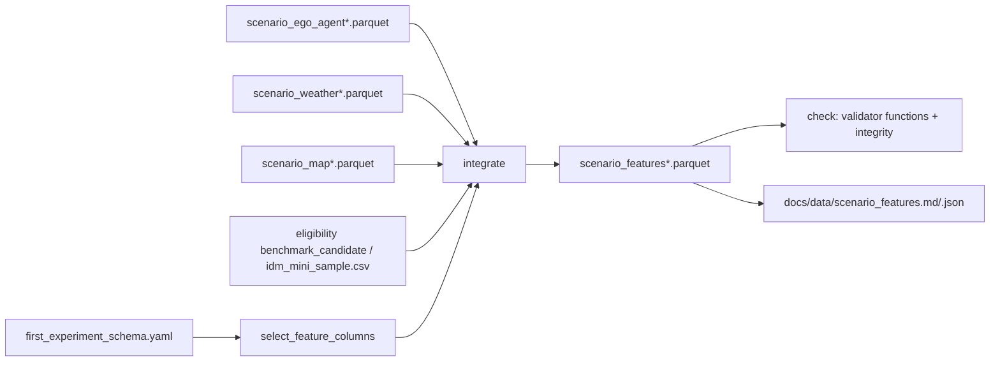

# Design Document: Feature Integration

## Overview

`tools/build_scenario_features.py` joins the ego/agent, weather and map tables on `scenario_id`, adds `map_name`, keeps only Schema model features, and writes `scenario_features.parquet` (1,406,469 candidates) and `scenario_features_mini_68.parquet` (68). It follows `tools/extract_ego_agent_features.py`: argparse subcommands, `from __future__ import annotations`, pandas/pyarrow, tmp + `os.replace` writes, provenance in parquet metadata, `PASS`/`FAIL` lines, exit codes 0/1/2. Language: Python.

The Schema edit is a one-time manual change (task), not code. The Builder selects columns from the Schema at run time, so the Schema stays the single source of truth.

## Architecture



## Components and Interfaces

All pure functions take DataFrames so tests use tiny synthetic frames; I/O lives in `cmd_build` / `cmd_check`.

```python
KEYS = ["scenario_id", "log_name", "scenario_token"]
LOCATION_COLUMNS = {"ego_x", "ego_y", "ego_heading"}

def select_feature_columns(schema: dict, available: set[str]) -> tuple[list[dict], list[str]]:
    """Model-feature fields (column or name) present in `available`, in Schema order, excluding
    map_name; plus names of model features not found (reported as not integrated)."""

def integrate(candidates: pd.DataFrame, sources: dict[str, pd.DataFrame], schema: dict) -> pd.DataFrame:
    """candidates: scenario_id, map_name (+ log_name, scenario_token if present).
    Raises CoverageError listing per-table absent counts and duplicate counts.
    Output: KEYS + map_name + features + <col>_missing for null_with_indicator features
    (copied from source when present, else derived as isna). Sorted by scenario_id."""

def check_table(df: pd.DataFrame, schema: dict, expected_rows: int) -> list[tuple[str, list[str]]]:
    """(check name, errors) pairs: validator.check_leakage, validator.check_feature_table_columns,
    forbidden patterns / location columns, unique scenario_id, row count, indicator == isna,
    no nulls in exclude_pair/fail_validation features, artifacts:[features] columns present."""

def build_report(df: pd.DataFrame, schema: dict, not_integrated: list[str]) -> dict
def write_parquet_atomic(df: pd.DataFrame, path: Path, metadata: dict) -> None
```

CLI (all paths are flags; defaults under `E:\Project\nuplan\processed\`):

| Flag | Default |
|---|---|
| `--ego`, `--ego-mini` | `features\scenario_ego_agent.parquet`, `..._mini_68.parquet` |
| `--weather`, `--weather-mini` | `weather\scenario_weather.parquet`, `..._mini_68.parquet` |
| `--map`, `--map-mini` | `features\scenario_map.parquet`, `..._mini_68.parquet` |
| `--eligibility` | `scenario_eligibility.parquet` (reads `scenario_id, log_name, scenario_token, map_name, benchmark_candidate` only) |
| `--mini-manifest` | `configs/scenarios/idm_mini_sample.csv` |
| `--out-dir` | `E:\Project\nuplan\processed\` |
| `--report-dir`, `--schema` | `docs/data`, Schema |
| `--only {full,mini,both}` | `both` |

Source tables are read with `pyarrow.parquet.read_table(columns=...)` limited to keys + selected features + their `_missing` columns, so `ego_x/ego_y/ego_heading` are never loaded.

Validator change: in `validate()`, when `features_path` ends with `.parquet`, read names via `pyarrow.parquet.read_schema(path).names`; otherwise keep `read_csv`.

## Data Models

Integrated columns (23 + indicators):
- keys: `scenario_id`, `log_name`, `scenario_token`; `map_name`
- ego/agent (9): `ego_speed`, `ego_acceleration`, `ego_yaw_rate`, `num_tracked_agents`, `num_vehicles`, `num_pedestrians`, `nearest_agent_distance_m`, `nearest_agent_relative_speed_mps`, `agents_within_50m`
- map (3): `lane_type`, `in_intersection`, `traffic_light_state`
- weather (10): `weather_*` fields and `sun_elevation_deg`
- `_missing` for each `null_with_indicator` feature (2 ego/agent, 3 map, 10 weather)

Not integrated (stay `unavailable`): `route_length_m`, `lane_curvature`. Excluded non-model: `ego_x`, `ego_y`, `ego_heading`, `lane_id`.

Schema edit: the 22 integrated fields get `status: available`, `column: <name>`, `artifacts: [features]`; `map_name` artifacts become `[manifest, outcomes, features]`.

Parquet metadata key `scenario_features_provenance` (JSON): tool version, UTC build time, Schema SHA-256, each input path, row count and byte size, output variant.

Report JSON: `{variant: {rows, columns, null_counts, rows_by_city}, not_integrated}`; city from Schema `city_by_map_name`. Markdown renders the same.

## Error Handling

- Missing file or required column: `InputError`, message to stderr, exit 2.
- Coverage gap or duplicate `scenario_id`: `CoverageError` with per-table counts, no output written, exit 1.
- `check` failures: `FAIL <name>: <first errors>` lines, exit 1.

## Correctness Properties

*A property is a characteristic or behavior that should hold true across all valid executions of a system-essentially, a formal statement about what the system should do. Properties serve as the bridge between human-readable specifications and machine-verifiable correctness guarantees.*

### Property 1: Column contract

For any synthetic Source_Tables containing the model features plus arbitrary extra columns (location, outcome-like, undeclared), the `integrate` output columns are exactly the Key_Columns, `map_name`, the selected features, and the `_missing` columns of `null_with_indicator` features.

**Validates: Requirements 1.1, 3.1**

### Property 2: Join faithfulness

For any fully covered candidate set and any row order of each Source_Table, `integrate` returns one row per candidate with unique `scenario_id`, and every feature cell equals the source cell for the same `scenario_id`.

**Validates: Requirements 1.2, 1.3**

### Property 3: Missing indicator consistency

For any feature column with randomly placed nulls and no source indicator, the derived `_missing` column equals the column's nullness, and `check_table` reports an error whenever any indicator value is flipped.

**Validates: Requirements 1.4, 4.2**

### Property 4: Coverage gaps are reported

For any random subset of candidate ids removed from any one Source_Table, `integrate` raises `CoverageError` whose count for that table equals the number removed.

**Validates: Requirements 2.1**

### Property 5: Forbidden columns fail the check

For any valid integrated table with one added column whose name contains a `forbidden_feature_patterns` entry or equals a location column, `check_table` reports at least one error.

**Validates: Requirements 3.2, 3.3**

## Testing Strategy

`tests/test_build_scenario_features.py`, unittest style, tiny synthetic frames and a minimal in-memory Schema dict. `hypothesis` is not installed, so properties use seeded `random` loops of 100 iterations each, tagged `Feature: feature-integration, Property N`. Example tests cover duplicates (2.2), missing file/column exit 2 (2.3), exclude_pair nulls and declared-column absence (4.3, 4.4), exit codes and PASS/FAIL output (4.5), provenance metadata and report files via a temp dir (5.1, 5.3), and the validator reading a parquet `--features` (6.2). The full suite (`.venv\Scripts\python.exe -m pytest -q -p no:subtests`) and `python -m tools.validate_scenario_subset` cover 6.1 and 6.3.
