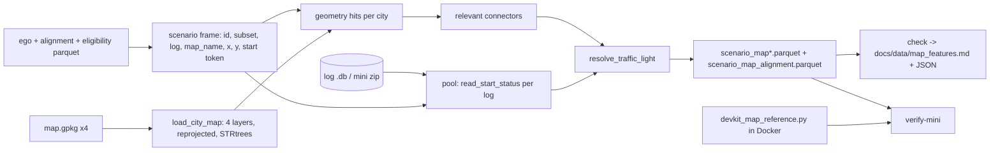

# Design Document: map-features

## Overview

`tools/extract_map_features.py` computes `lane_type`, `in_intersection` and `traffic_light_state` at the ego rear-axle pose of the start lidar frame for the 1,406,469 benchmark Candidates and the 68 Mini_Scenarios. Geometry is evaluated per city with vectorised shapely queries. Traffic-light records are read per log, in a process pool, for the start tokens only. A second script, `tools/devkit_map_reference.py`, runs inside the planner Docker image and produces the Devkit_Reference for `verify-mini`.

All measurements below were taken read-only on 2026-11-06 against `E:\Project\nuplan\processed` and `C:\nuplan\dataset`.

### Measurements and decisions

| # | Question | Finding | Decision |
|---|---|---|---|
| D1 | Geometry library | `.venv` had neither shapely nor geopandas. GPKG geometries are standard GeoPackage blobs (`GP` header + WKB). | Use **shapely 2.2.0** and **pyproj 3.7.2** (both now installed in `.venv`), reading layers with stdlib `sqlite3` and stripping the GPKG header. geopandas/pyogrio (GDAL) are not needed for four layers per city. |
| D2 | Coordinate frame | The requirements assumption is wrong. Layer coordinates are WGS84 lon/lat (Pittsburgh lane bounds -79.97..-79.95, 40.41..40.43), not UTM. Each `map.gpkg` has a `meta` row `projectedCoordSystem`: sg-one-north `epsg:32648`, us-ma-boston `epsg:32619`, us-nv-las-vegas-strip `epsg:32611`, us-pa-pittsburgh-hazelwood `epsg:32617`. Without reprojection, 0% of ego points hit any polygon. | Reproject every geometry once per city from EPSG:4326 to the `projectedCoordSystem` (`always_xy=True`), the same transform the devkit map loader applies. The CRS is recorded in provenance. Requirement 7 stays as the guard. |
| D3 | Share on lane/connector after reprojection (2,000 random Candidates per city, seed 0) | sg-one-north 99.95% (lane 75.5%, connector-only 24.45%, both 0.05%, none 0.05%); us-ma-boston 100% (73.15% / 26.85%); us-nv-las-vegas-strip 100% (55.5% / 44.5%); us-pa-pittsburgh-hazelwood 100% (85.75% / 14.25%). `in_intersection` share equals the connector-only share in each city. | The 0.90 default threshold has ample margin. |
| D4 | Lane ∩ connector | Only sg-one-north showed it, in 1 of 2,000 points (0.05%). No point was in more than one lane. | Keep the "lane wins" rule. Ego_Lane and Ego_Connector are stored as fid lists so ties stay auditable. |
| D5 | Upstream lane of a connector | For all 594 Pittsburgh connectors, the first vertex of the `lane_connectors` linestring is on the `exit_lane_fid` lane (median distance 0.0 m) and is closer to it than to `entry_lane_fid` in 100% of cases. This matches the devkit, where `incoming_edges` uses `exit_lane_fid`. | **`exit_lane_fid` is the upstream lane.** The lane connectors leaving the Ego_Lane are those with `exit_lane_fid` ∈ Ego_Lane fids. |
| D6 | Lane ids | `lanes_polygons.fid == lane_fid` for every row in all four maps. Every `exit_lane_fid` exists in `lanes_polygons.fid`. | Use `lanes_polygons.fid` as the lane id. |
| D7 | Connector polygon linkage | `gen_lane_connectors_scaled_width_polygons.fid` is its own id space (0 overlap with `lane_connectors.fid`). Its `lane_connector_fid` is unique and is always a `lane_connectors.fid` (all 1,547 / 1,789 / 2,544 / 594 polygons in sg / boston / las-vegas / pittsburgh). | The connector id is `lane_connector_fid`, never the polygon `fid`. |
| D8 | `traffic_light_status` ids | Columns `token, lidar_pc_token (BLOB), lane_connector_id, status`. In a Pittsburgh log, all 37 distinct `lane_connector_id` values are in `lane_connectors.fid` and none are in the polygon `fid`. Observed statuses: `green` and `red`. There is no index on `lidar_pc_token`. | Match `lane_connector_id` against `lane_connectors.fid`. Query each log once with `WHERE lidar_pc_token IN (...)` using `bytes.fromhex(start_lidar_token)`. |
| D9 | Inputs | Ego, mini ego and alignment tables are in `E:\Project\nuplan\processed\features\`. The alignment table has `subset` ∈ {`trainval_candidates` 1,406,469, `mini_68` 68}. `map_name` and `db_file` come from `scenario_eligibility.parquet` (filter `benchmark_candidate`). The 7,353 trainval DBs and the maps are on `C:\nuplan\dataset` only. The mini sample CSV gives `map_name` for the 68 Mini_Scenarios (38 logs). | Defaults below follow these locations. |
| D10 | Boundary rule | The requirement says boundary counts as inside. | Use STRtree `predicate="intersects"` (point on boundary = hit). `verify-mini` reports any disagreement with the devkit, which uses `contains`. |

### Performance plan (measured)

- Loading the 1.4M-row ego, alignment and filtered eligibility columns: 12.8 s.
- STRtree query of all city points against lanes, connector polygons and intersections: 0.5 s (Singapore), 0.5 s (Boston), 2.9 s (Las Vegas), 0.8 s (Pittsburgh). Map load and reprojection is a few seconds per city.
- Status lookup: 20 Pittsburgh logs in 1.2 s (about 0.06 s per log, one IN query per log). About 2,639 logs give roughly 160 s serial, under 40 s with the default worker count.
- Expected `build` wall time: under 5 minutes. Geometry runs in the main process; only DB reads use the pool.

## Architecture



## Components and Interfaces

Module layout of `tools/extract_map_features.py` (header `from __future__ import annotations`, `_bootstrap` like sibling tools). Pure functions take shapely geometries and plain Python/NumPy values so tests need no nuPlan files.

```python
# --- constants
FEATURE_VERSION = "map-v1"
LANE_TYPES = ("lane", "lane_connector", "none")
TL_STATES = ("red", "yellow", "green", "unknown", "none")
RESTRICTIVENESS = {"red": 3, "yellow": 2, "green": 1}

# --- GeoPackage I/O
def strip_gpkg_header(blob: bytes) -> bytes: ...             # envelope size from flags bits 1-3
def read_layer(conn, table: str, columns: list[str]) -> tuple[pd.DataFrame, np.ndarray]: ...
def projected_crs(conn) -> str: ...                          # meta.projectedCoordSystem
@dataclass
class CityMap:                                               # geometries already in UTM metres
    map_name: str; version: str; crs: str
    lane_fids: np.ndarray; lane_tree: STRtree
    conn_ids: np.ndarray; conn_tree: STRtree                 # ids = lane_connector_fid
    inter_fids: np.ndarray; inter_tree: STRtree
    outgoing: dict[int, list[int]]                           # exit_lane_fid -> [lane_connectors.fid]
def load_city_map(maps_dir: Path, map_name: str, version: str) -> CityMap: ...

# --- pure rules
def point_hits(tree: STRtree, ids: np.ndarray, x: np.ndarray, y: np.ndarray) -> list[list[int]]: ...
def classify_lane_type(lane_hits: list[int], conn_hits: list[int]) -> str: ...
def relevant_connectors(conn_hits: list[int], lane_hits: list[int], outgoing: dict[int, list[int]]) -> tuple[list[int], str]: ...
    # returns (ids, source) with source in {"ego_connector", "ego_lane_outgoing", "none"}
def resolve_traffic_light(relevant: list[int], records: list[tuple[int, str]]) -> tuple[str, int, int]: ...
    # returns (state, matched_record_count, ignored_status_count); statuses lower-cased
def geometry_features(city: CityMap, frame: pd.DataFrame) -> pd.DataFrame: ...

# --- DB
def read_start_status(db_path: Path, tokens_hex: list[str]) -> list[tuple[str, int, str]]: ...
    # (token_hex, lane_connector_id, status) for the given tokens only
def status_worker(task: tuple[str, Path, list[str]]) -> dict: ...  # {"log_name", "rows" | "error"}

# --- orchestration
def load_frames(args) -> pd.DataFrame: ...       # validates paths and columns, exits 2 on error
def build(args) -> int: ...
def check(args) -> int: ...
def verify_mini(args) -> int: ...
def write_parquet(df: pd.DataFrame, path: Path, meta: dict) -> None: ...  # tmp + os.replace
def main(argv=None) -> int: ...
```

### build flow

1. `load_frames`: read the needed columns, join ego ⋈ alignment (on `scenario_id`, subset-specific) ⋈ eligibility (`map_name`, `db_file`, candidates) or ⋈ mini sample CSV (`map_name`, `db_file`, mini). Map versions come from `nuplan-maps-v1.0.json`.
2. Per `map_name`: `load_city_map`, then `geometry_features` gives lane hits, connector hits, intersection hits, `lane_type`, `in_intersection` and the relevant connectors.
3. Status records: trainval logs are submitted to `ProcessPoolExecutor(--workers)`, one task per log with that log's start tokens. Mini logs are processed sequentially. Each of the 38 needed DBs is copied from the zip into `--scratch/map_mini/`, queried, then deleted, as in `extract_ego_agent_features.build_mini`.
4. `resolve_traffic_light` per scenario, then null-out rules (Error Handling), then write the outputs and `mini_68_reference_input.parquet` (see verify-mini).

### CLI

`python tools/extract_map_features.py {build,check,verify-mini} [flags]`

| Flag | Default |
|---|---|
| `--ego` | `E:\Project\nuplan\processed\features\scenario_ego_agent.parquet` |
| `--mini-ego` | `E:\Project\nuplan\processed\features\scenario_ego_agent_mini_68.parquet` |
| `--alignment` | `E:\Project\nuplan\processed\features\scenario_ego_agent_alignment.parquet` |
| `--eligibility` | `E:\Project\nuplan\processed\scenario_eligibility.parquet` |
| `--mini-sample` | `configs/scenarios/idm_mini_sample.csv` |
| `--db-dir` | `C:\nuplan\dataset\nuplan-v1.1\trainval` |
| `--mini-zip` | `E:\Project\nuplan\downloads\nuplan-v1.1_mini.zip` |
| `--maps-dir` | `C:\nuplan\dataset\maps` (version file `nuplan-maps-v1.0.json` inside) |
| `--out-dir` | `E:\Project\nuplan\processed\features` |
| `--scratch` | `E:\Project\nuplan\scratch` |
| `--report-dir` | `docs/data` |
| `--reference-dir` | `artifacts/additional_planners/map_reference` |
| `--workers` | `max(1, cpu_count - 4)` |
| `--frame-threshold` | `0.90` |
| `--limit-logs` | none (smoke test: first N trainval logs, outputs get a `_smoke` suffix) |

### verify-mini and the devkit reference

Docker mounts `/data` = `C:/nuplan/dataset` (read-only), `/workspace` = repo (read-only) and `/artifacts` = `./artifacts/additional_planners`. The mini zip is not mounted. **Decision:** `build` writes `<reference-dir>/mini_68_reference_input.parquet` with `scenario_id, map_name, ego_x, ego_y, start_lidar_token, status_records` (list of `{lane_connector_id, status}` as read from the Start_Frame, unfiltered). This avoids copying about 38 mini DBs into the artifact mount. The devkit script then independently checks geometry, connector linkage, connector direction and the restrictiveness rule. The SQL read of start-frame records is covered by unit tests rather than the devkit.

`tools/devkit_map_reference.py` (imports nuplan lazily; `--help` works without it):

```text
args: --input /artifacts/map_reference/mini_68_reference_input.parquet
      --output /artifacts/map_reference/devkit_map_mini_68.parquet
      --maps-root /data/maps --map-version nuplan-maps-v1.0
for each row:
    api   = get_maps_api(maps_root, map_version, row.map_name)      # NuPlanMapFactory, cached per map
    p     = Point2D(row.ego_x, row.ego_y)
    lanes = api.get_all_map_objects(p, SemanticMapLayer.LANE)
    conns = api.get_all_map_objects(p, SemanticMapLayer.LANE_CONNECTOR)
    inter = api.get_all_map_objects(p, SemanticMapLayer.INTERSECTION)
    lane_type = "lane" if lanes else "lane_connector" if conns else "none"
    relevant  = {c.id for c in conns} or {e.id for l in lanes for e in l.outgoing_edges}
    tl = most restrictive of status_records with str(id) in relevant, else "unknown" if relevant else "none"
write scenario_id, lane_type, in_intersection=bool(inter), traffic_light_state (+ id lists for diagnosis)
```

Command (run only when the planner containers are idle):
`docker compose --project-directory . -f infra/docker/compose.planners.yaml run --rm planner python -m tools.devkit_map_reference`

`verify-mini --reference artifacts/additional_planners/map_reference/devkit_map_mini_68.parquet` compares per scenario and feature, prints `agree n/68` per feature, lists each disagreeing `scenario_id` with both values, and exits 0 only on 68/68 for all three features.

## Data Models

`scenario_map.parquet` (1,406,469 rows) and `scenario_map_mini_68.parquet` (68 rows), sorted by `scenario_id`:

| Column | Type |
|---|---|
| `scenario_id` | string, unique |
| `lane_type` | string (nullable): `lane` / `lane_connector` / `none` |
| `lane_type_missing` | bool |
| `in_intersection` | bool (nullable) |
| `in_intersection_missing` | bool |
| `traffic_light_state` | string (nullable): `red` / `yellow` / `green` / `unknown` / `none` |
| `traffic_light_state_missing` | bool |

The `*_missing` columns are always written, including when they are all False.

`scenario_map_alignment.parquet` (1,406,537 rows, both subsets):

| Column | Type |
|---|---|
| `subset` | string: `trainval_candidates` / `mini_68` |
| `scenario_id`, `log_name`, `map_name`, `map_version`, `map_crs` | string |
| `start_lidar_token` | string |
| `ego_lane_fids` | list<int64> |
| `ego_connector_fids` | list<int64> (`lane_connector_fid`) |
| `intersection_fids` | list<int64> |
| `relevant_connector_fids` | list<int64> (`lane_connectors.fid`) |
| `relevant_source` | string: `ego_connector` / `ego_lane_outgoing` / `none` |
| `status_record_count` | int64 (records at the Start_Frame matching Relevant_Connectors) |
| `start_frame_record_count` | int64 (all records at the Start_Frame) |
| `ignored_status_count` | int64 (matching records with a status other than red/yellow/green) |

Fid lists replace single fids so that multiple hits stay auditable (decision D4).

Provenance is stored in schema metadata key `map_features_provenance` as JSON: `feature_version`, `created_utc`, tool `argv` and parsed args, each input path with its size in bytes and mtime, `maps` (`map_name` → version, CRS, gpkg path and size), and the shapely/pyproj versions.

## Error Handling

| Condition | Behaviour | Exit |
|---|---|---|
| Missing input file/dir (only those the subcommand needs) | Print `missing input: <path>` for each, write nothing | 2 |
| Input table lacks a needed column | Print table path and the missing column names | 2 |
| `map_name` not in versions JSON or gpkg missing | That city's three features null, `*_missing` True | continue |
| `ego_x`/`ego_y` null or scenario absent from the ego table | `lane_type`, `in_intersection`, `traffic_light_state` null | continue |
| `start_lidar_token` null, log DB missing or unreadable, or worker error | `traffic_light_state` null; error recorded in report | continue |
| Unknown status string | Ignored as no record, counted in `ignored_status_count` | continue |
| Any `check` / `verify-mini` failure | FAIL line | 1 |

Each output file is written to `<name>.tmp` and moved with `os.replace`, so a failed run leaves earlier outputs intact. Scratch mini DBs are deleted in `finally`.

## check

Prints one `[PASS]`/`[FAIL]` line per check, writes `docs/data/map_features.md` and `docs/data/map_features.json` (per-city value counts, missing counts, check results, added dependencies shapely and pyproj), and exits 0 only if all pass.

1. Row count of each Map_Table equals its input scenario count (1,406,469 / 68), and the id sets are equal.
2. `scenario_id` unique in each Map_Table and in the Audit_Table.
3. Each feature column only contains allowed values or null.
4. `*_missing` equals `isna()` of its feature, for all three features in both tables.
5. Audit_Table ids equal the union of both Map_Tables.
6. Frame alignment: per city, share of Candidates with `lane_type` ∈ {lane, lane_connector} ≥ `--frame-threshold`. Each FAIL line names the city and the share.
7. Map_Table columns are exactly the seven listed above, so no fid columns leak into model inputs.

## Correctness Properties

*A property is a characteristic or behavior that should hold true across all valid executions of a system-essentially, a formal statement about what the system should do. Properties serve as the bridge between human-readable specifications and machine-verifiable correctness guarantees.*

### Property 1: lane_type decision table

For any set of synthetic lane polygons, connector polygons and any point, `lane_type` is `lane` iff some lane polygon covers the point, `lane_connector` iff some connector covers it and no lane does, and `none` otherwise.

**Validates: Requirements 2.1, 2.2, 2.3**

### Property 2: in_intersection matches coverage

For any set of synthetic intersection polygons and any point, `in_intersection` is True iff some intersection polygon covers the point (boundary included).

**Validates: Requirements 3.1, 3.2**

### Property 3: Traffic-light resolution

For any relevant connector set and any list of `(lane_connector_id, status)` records, `resolve_traffic_light` returns the most restrictive red/yellow/green status among records whose id is relevant (case-insensitive). It returns `unknown` when the set is non-empty and has no such record, and `none` when the set is empty. The result is unchanged by permuting the records or adding records for non-relevant ids or with unrecognised statuses.

**Validates: Requirements 4.1, 4.2, 4.3**

### Property 4: Start-frame isolation

For any synthetic SQLite `traffic_light_status` table with records spread over several `lidar_pc_token` values, `read_start_status` returns exactly the records whose token is in the requested start tokens.

**Validates: Requirements 4.4**

### Property 5: Missing indicators and row coverage

For any synthetic scenario frame, including null ego points, unknown maps and missing DBs, the Map_Table has one row per input `scenario_id`, and each `*_missing` column equals the null mask of its feature.

**Validates: Requirements 2.4, 3.3, 4.5, 5.1, 6.3**

## Testing Strategy

`tests/test_extract_map_features.py` uses `unittest` like the sibling tests (no hypothesis in `.venv`). Property tests are loops of 100 cases from `random.Random(seed)`. Each test docstring carries the tag `Feature: map-features, Property N: <title>`.

- Property tests 1–5 on synthetic axis-aligned polygons, a small in-memory `CityMap`, and a temporary SQLite file.
- Example tests: `strip_gpkg_header` on hand-built blobs (envelope codes 0 and 1) round-tripping a shapely WKB; a point exactly on a polygon edge counts as inside; `relevant_connectors` uses `exit_lane_fid`; a tiny GeoPackage fixture written with sqlite3 and reprojected through `load_city_map` (EPSG:4326 → 32617) puts a known UTM point in its lane.
- CLI tests: missing input path exits 2 before any output exists; missing column exits 2 and names it; `check` on a hand-built table with a 0.5 city share prints a FAIL line naming the city; atomic write leaves no `.tmp`.
- `tools/devkit_map_reference.py --help` runs without nuplan installed.
- Real-data validation (manual): `build`, `check`, then the Docker reference and `verify-mini`.
- Gate: `.venv\Scripts\python.exe -m pytest -q` passes.
