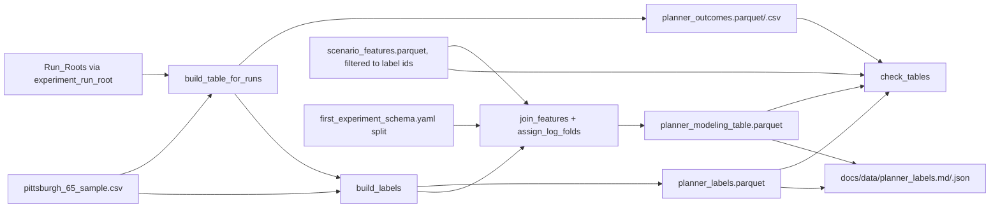

# Design Document: Planner Outcome Labels

## Overview

`tools/build_planner_labels.py` turns the Pittsburgh 65 x 5 planner runs into three data products and a report:

1. `planner_outcomes.parquet` / `.csv` (long, one row per `scenario_id` x Planner) under the Experiment_Root, produced by the existing `build_table_for_runs`.
2. `planner_labels.parquet` (wide, one row per scenario) in the Out_Dir.
3. `planner_modeling_table.parquet` (labels inner-joined with `scenario_features.parquet`, plus `fold`) in the Out_Dir.
4. `docs/data/planner_labels.md` and `.json` (committed).

It follows `tools/build_scenario_features.py`: argparse subcommands `build` and `check`, `from __future__ import annotations`, pandas/pyarrow, tmp + `os.replace` writes, provenance in parquet metadata, `PASS`/`FAIL` lines, exit codes 0/1/2. It reuses `assign_log_folds`, `check_log_split`, `load_schema` and `sha256_file` from `tools/validate_scenario_subset.py`, `arrow_schema` from `tools/build_scenario_features.py`, and `build_table_for_runs` / `experiment_run_root` from `causal_planner`. None of those are modified. Language: Python 3.11.

`--planners` selects any subset that contains `idm` (default all five), so the tool runs today on `idm,pdm-closed` and later on all five without code changes.

## Architecture



## Components and Interfaces

Pure functions take DataFrames so tests use small synthetic frames; I/O lives in `cmd_build` / `cmd_check`.

```python
TOOL_VERSION = "planner-labels-v1"
PROVENANCE_KEY = b"planner_labels_provenance"
PLANNER_ORDER = ("idm", "pdm-closed", "pdm-hybrid", "urban-driver", "gc-pgp")
CONTROL = "idm"
TIE_TOLERANCE = 1e-9            # same convention as build_paired_dataset.pair_outcome
KEYS = ["scenario_id", "log_name", "scenario_token"]
CONTEXT = KEYS + ["scenario_type", "map_name"]
LABEL_PREFIXES = ("score_", "delta_", "succeeded_")

class InputError(Exception): ...        # exit 2
class CoverageError(Exception):         # exit 1; .absent (count), .examples (first ids)
    ...

def token(planner: str) -> str:
    """'pdm-closed' -> 'pdm_closed'."""

def parse_planners(value: str) -> list[str]:
    """Comma list -> planners in PLANNER_ORDER. InputError if idm missing, unknown or repeated."""

def label_columns(planners: list[str]) -> list[str]:
    """score_<t> per planner, delta_<t>_vs_idm per non-idm planner, succeeded_<t> per planner, best_planner."""

def find_failures(outcomes: pd.DataFrame, sample: pd.DataFrame, planners: list[str]) -> dict[str, list[str]]:
    """{scenario_id: reasons}; one reason per planner that has no row, succeeded False
    ('<p>: simulation failed (<error_message or 'no message'>)') or null score ('<p>: missing score')."""

def best_planner(scores: dict[str, float], planners: list[str]) -> str:
    """Token of the first planner in PLANNER_ORDER whose score >= max(scores) - TIE_TOLERANCE."""

def build_labels(outcomes, sample, planners) -> tuple[pd.DataFrame, dict[str, list[str]]]:
    """Pivot the long table to one row per non-failed sample scenario, sorted by scenario_id.
    Columns: CONTEXT + label_columns(planners). delta computed as score_p - score_idm (float64)."""

def join_features(labels: pd.DataFrame, features: pd.DataFrame, split: dict) -> pd.DataFrame:
    """Inner join on scenario_id. CoverageError when a label id is absent from features.
    log_name/scenario_token/map_name must agree between both sides, else CoverageError with the
    mismatch count. The feature-side copies of those identity columns are dropped after the check.
    fold = assign_log_folds(rows, split['folds'], split['seed'])[log_name]."""

def feature_columns(features_columns: list[str]) -> list[str]:
    """All feature table columns except KEYS (map_name stays a feature-table column)."""

def check_tables(outcomes, labels, modeling, sample, feature_ids, feature_cols, provenance,
                 planners, schema) -> list[tuple[str, list[str]]]:
    """(check name, errors): unique_ids, row_counts, outcome_completeness, delta_exact,
    score_range, feature_coverage, column_separation, log_folds."""

def write_parquet_atomic(df, path, metadata) -> None:
    """Like build_scenario_features.write_parquet_atomic (reuses its arrow_schema) but stores
    PROVENANCE_KEY; writes <path>.tmp then os.replace; removes the tmp on failure."""

def build_report(outcomes, labels, modeling, sources, failures, planners, coverage) -> dict
def markdown_report(report: dict) -> str
```

`write_parquet_atomic` in `build_scenario_features.py` hard-codes `scenario_features_provenance`, so this tool keeps a small local writer with its own key and imports `arrow_schema` instead of copying it.

Reading the 1.4M-row Feature_Table: `pyarrow.parquet.read_table(path, filters=[("scenario_id", "in", ids)])`, so only label scenarios are loaded. The full column list comes from `pq.read_schema(path).names`.

CLI (every path a flag):

| Flag | Default |
|---|---|
| `--output-root` | `artifacts/additional_planners` |
| `--experiment` | `pittsburgh_65_five` |
| `--planners` | `idm,pdm-closed,pdm-hybrid,urban-driver,gc-pgp` |
| `--sample` | `configs/scenarios/pittsburgh_65_sample.csv` |
| `--features` | `E:\Project\nuplan\processed\scenario_features.parquet` |
| `--out-dir` | `E:\Project\nuplan\processed\labels\pittsburgh_65_five` |
| `--report-dir` | `docs/data` |
| `--schema` | `configs/features/first_experiment_schema.yaml` |
| `--overwrite` | off (`build` only) |

Paths are built with `pathlib` from `experiment_run_root`; Run_Roots are long on Windows, so the tool never shortens or re-joins them as strings. The Experiment_Root is `experiment_run_root(output_root, experiment, "idm").parent`, as in `tools/run_five_planners.py`.

`build` order: parse planners, check every output path (exit 2 if one exists without `--overwrite`), call `build_table_for_runs`, compute labels and modeling table in memory, then write outcomes, labels, modeling table and Report. Nothing is written if any earlier step fails.

`check` reads the three tables, the Sample, the Feature_Table schema and `scenario_id` column, and the provenance, then runs `check_tables`. The Included_Planners come from the provenance `planners`.

## Data Models

Outcome_Table: exactly the `build_table_for_runs` frame (`scenario_id`, `log_name`, `scenario_token`, `scenario_type`, `map_name`, timestamps, the nine `OUTCOMES` metrics, `succeeded`, `error_message`, `planner`, `run_id`, `sample_sha256`, commits, `checkpoint_sha256`). Experiment-level sources (official scores, report hashes) go into its parquet metadata under the same `planner_labels_provenance` key.

Label_Table (example for `idm,pdm-closed`):

| Column | Type |
|---|---|
| `scenario_id`, `log_name`, `scenario_token`, `scenario_type`, `map_name` | string |
| `score_idm`, `score_pdm_closed` | float64 |
| `delta_pdm_closed_vs_idm` | float64 |
| `succeeded_idm`, `succeeded_pdm_closed` | bool |
| `best_planner` | string (Planner_Token) |

With five planners: five `score_`, four `delta_`, five `succeeded_` columns.

Modeling_Table: Label_Table columns + Feature_Columns (22 features, 15 `_missing` flags, `map_name` shared with the labels) + `fold` (int64).

Provenance JSON (`planner_labels_provenance`): `tool_version`, `built_utc`, `planners`, `run_roots` (planner -> path), `label_columns`, `feature_columns`, `sha256` (`sample`, `features`, `schema`), `excluded` (scenario_id -> reasons), `split` (`folds`, `seed`, `group`).

Report JSON: `{rows: {outcomes, labels, modeling, sample}, planners, scores: {token: {mean, official}}, deltas: {column: {mean, median, std, share_positive}}, best_planner_counts, failed: {scenario_id: reasons}, fold_sizes, coverage: {label_ids, in_features, absent}}`. Markdown renders the same tables.

## Error Handling

- Unknown, repeated or missing-`idm` planner list; missing input file or column; existing output without `--overwrite`: `InputError`, message to stderr, exit 2.
- `build_table_for_runs` error (incomplete or invalid run): message to stderr, exit 1, no output written.
- Feature coverage gap or identity mismatch: `CoverageError` with counts and first ids, exit 1, no Modeling_Table written.
- `check` failures: `FAIL <name>: <first errors>` lines, exit 1.

## Correctness Properties

*A property is a characteristic or behavior that should hold true across all valid executions of a system-essentially, a formal statement about what the system should do. Properties serve as the bridge between human-readable specifications and machine-verifiable correctness guarantees.*

### Property 1: Label faithfulness and delta exactness

For any synthetic long outcome table over any Planner subset containing `idm`, in any row order, every Label_Table `score_<token>` and `succeeded_<token>` cell equals the source cell for the same `scenario_id` and Planner, and every `delta_<token>_vs_idm` equals `score_<token> - score_idm` exactly; perturbing any one delta makes `check_tables` report a `delta_exact` error.

**Validates: Requirements 2.2, 2.3, 5.3**

### Property 2: Best planner consistency

For any score vector over any Planner subset, including deliberately generated ties within the Tie_Tolerance, `best_planner` names a Planner whose score is at least the maximum minus the Tie_Tolerance, and no Planner earlier in the Planner_Order satisfies that bound.

**Validates: Requirements 2.4**

### Property 3: Failed scenarios are excluded

For any random set of failures (`succeeded` false, null `score`, or a dropped row) injected into a complete long table, the Label_Table `scenario_id` set equals the Sample ids minus the failed ids, every failed id has one reason per failing Planner, and the Outcome_Table input is unchanged.

**Validates: Requirements 2.5, 3.1, 3.2**

### Property 4: Coverage gaps are reported

For any random non-empty subset of label ids removed from a synthetic Feature_Table, `join_features` raises `CoverageError` whose absent count equals the number removed.

**Validates: Requirements 4.2, 5.4**

### Property 5: Folds are disjoint by log

For any synthetic label set with random log sizes, the Modeling_Table assigns each `log_name` to exactly one `fold`, and moving one row of a multi-scenario log to another fold makes `check_tables` report a `log_folds` error.

**Validates: Requirements 4.4, 5.6**

### Property 6: Label and feature columns are separate

For any random Planner subset and Feature_Table with random extra feature columns, the Modeling_Table columns equal the Label_Table columns plus Feature_Columns plus `fold`, the provenance `label_columns` and `feature_columns` are disjoint and match `label_columns(planners)` and the Feature_Columns, and adding a Feature_Table column named with a Label_Columns prefix, `best_planner`, or a `forbidden_feature_patterns` entry makes `check_tables` report a `column_separation` error.

**Validates: Requirements 2.1, 4.1, 4.5, 5.5**

## Testing Strategy

`tests/test_build_planner_labels.py`, unittest style, synthetic long outcome frames, synthetic feature parquet and a minimal in-memory Schema dict, all in `tempfile.TemporaryDirectory()`; no simulation runs, no E: paths, no writes to `docs/data` (every test passes `--out-dir`, `--report-dir`, `--features` and `--output-root` explicitly). `hypothesis` is not installed, so properties use seeded `random` loops of 100 iterations each, tagged `Feature: planner-outcome-labels, Property N`.

Example tests: `parse_planners` errors (1.1, 1.2); `cmd_build` with `build_table_for_runs` patched to return a synthetic frame and to raise (1.3, 1.4, 1.5), asserting the Run_Roots it receives come from `experiment_run_root`; identity mismatch (4.3); provenance keys (4.5); duplicate ids and row-count failures (5.1, 5.2); CLI `build` + `check` exit codes 0/1/2 and `PASS`/`FAIL` lines (5.7); existing output without `--overwrite` (6.3); no `.tmp` left after a write (6.2); Report JSON and Markdown contents in a temp report dir (6.4). The full suite (`.venv\Scripts\python.exe -m pytest -q -p no:subtests`) covers 7.1 and 7.3, including `tests/test_repository_layout.py`.
