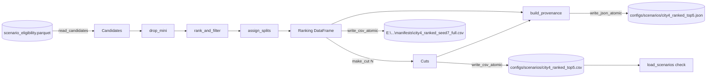

# Design Document: Ranked 4-City Manifest

## Overview

`tools/freeze_manifest.py` turns the eligibility table into one frozen, deterministic ranking of benchmark scenarios for boston, las_vegas, pittsburgh and singapore, assigns every drive to train, val or test, and writes per-group cuts (top N per city/type group) with a provenance record. A `check` subcommand re-validates a frozen cut against the table and its provenance.

The tool reuses the selection logic of `tools/freeze_pittsburgh_sample.py` (seeded SHA-256 rank key, per-drive interval filter, rarest group first) and the CLI conventions of `tools/build_scenario_eligibility.py` (argparse subcommands, `from __future__ import annotations`, integer exit codes, `[PASS]`/`[FAIL]` lines). All selection, split and check logic lives in pure functions over pandas DataFrames so that tests run on synthetic frames without file I/O.

### Measurements (current table)

Measured with a read-only script against `E:\Project\nuplan\processed\scenario_eligibility.parquet` (1,105,388,965 bytes), seed 7:

| Quantity | Value |
|---|---|
| Candidate rows (`benchmark_candidate` True) | 1,406,469 |
| Candidates removed by the mini guard (Req 1.2) | 0 (the table already excludes them; the guard stays as a defensive check) |
| Ranking rows after the overlap filter | 15,838 |
| Drives in the Ranking | 828 (boston 208, las_vegas 98, pittsburgh 193, singapore 329) |
| Non-empty groups | 53 of 56 |
| Group sizes in the Ranking | min 1, median 131, max 1,495 |
| Groups with fewer than 5 rows | las_vegas/high_lateral_acceleration (1), singapore/following_lane_with_lead (3) |
| Full Ranking CSV size (all 14 columns) | 6.18 MB |
| SHA-256 of the parquet file | 4.7 s |
| Read candidate columns | 1.0 s |
| Rank keys for 1.4 M rows | 2.3 s |
| Overlap filter, all cities | 7.6 s |

### Decisions

1. **Full Ranking location.** The full Ranking CSV is 6.18 MB, above the ~5 MB commit threshold, and grows with each table rebuild. It is written outside Git to `E:\Project\nuplan\processed\manifests\city4_ranked_seed7_full.csv`; its SHA-256 and row counts are recorded in the committed Provenance. Only cuts are committed. The default build writes the demo cut N=5 (at most 5 × 53 = 265 rows, about 0.1 MB).
2. **Eligibility fingerprint.** A full streaming SHA-256 of the parquet file takes 4.7 s, well under the 30 s budget. The tool records `eligibility_sha256` (full file hash, 16 MiB chunks) plus `eligibility_bytes`. A content-projection fingerprint was rejected: it would add canonicalisation code that must itself be tested, and it would hide table rewrites that change other columns.
3. **Cut interface: `build --per-group N` (repeatable, default `[5]`).** One `build` invocation computes the Ranking once and derives every requested cut from that in-memory Ranking, so nesting (Req 2.6) holds by construction. All target paths of the invocation (ranking, every cut, provenance) are known before any work and are checked together, so the no-overwrite rule (Req 7.1) is all-or-nothing. A separate `cut` subcommand was rejected because the approved requirements define only `build` and `check`, and it would need a second provenance format and a re-read of the external Ranking. A later training cut is produced by a new `build` run with new output names (for example `--per-group 5 --per-group 50 --prefix city4_ranked_v2`); because `build` is deterministic (Req 2.5), equal `eligibility_sha256`, `seed` and `ranking_sha256` in two provenance files prove both runs used the same Ranking, and therefore that the demo cut is a prefix of the training cut.

## Architecture



The I/O shell (`build`, `check`, `main`) reads files, calls the pure core, and writes outputs. The pure core never touches the file system.

## Components and Interfaces

All functions live in `tools/freeze_manifest.py`; tests import them as `from tools.freeze_manifest import ...`.

### Constants

```python
TOOL_VERSION = "freeze-manifest-v1"
CITIES = ("boston", "las_vegas", "pittsburgh", "singapore")
BENCHMARK_TYPES  # imported from tools.build_scenario_eligibility (14 types)
DEFAULT_ELIGIBILITY = Path("E:/Project/nuplan/processed/scenario_eligibility.parquet")
DEFAULT_RANKING = Path("E:/Project/nuplan/processed/manifests/city4_ranked_seed{seed}_full.csv")
DEFAULT_OUTPUT_DIR = PROJECT_ROOT / "configs" / "scenarios"
DEFAULT_PREFIX = "city4_ranked"
DEFAULT_SEED = 7
DEFAULT_RATIOS = (0.70, 0.15, 0.15)
READ_COLUMNS = ["scenario_id", "log_name", "db_file", "scenario_token", "anchor_timestamp_us",
                "benchmark_scenario_type", "all_scenario_tags", "map_name", "source_recording",
                "window_start_us", "window_end_us", "source_city", "benchmark_candidate",
                "shares_mini_recording", "in_mini_split", "eligibility_version"]
MANIFEST_COLUMNS = ["scenario_id", "log_name", "db_file", "scenario_token", "anchor_timestamp_us",
                    "scenario_type", "all_scenario_tags", "map_name", "source_recording",
                    "window_start_us", "window_end_us", "source_city", "group_rank", "split"]
```

`READ_COLUMNS` contains only identifier, timing, map, tag and eligibility-flag columns (Req 1.4). No outcome or simulation columns exist in the table, and none are read.

### Pure core

```python
def rank_key(seed: int, scenario_id: str) -> str
    # sha256(f"{seed}:{scenario_id}").hexdigest()[:16]

def split_key(seed: int, drive: str) -> str
    # sha256(f"{seed}:split:{drive}").hexdigest()

def missing_columns(columns: Iterable[str]) -> list[str]           # sorted, Req 1.3
def drop_mini(candidates: DataFrame) -> tuple[DataFrame, int]      # Req 1.2
def rank_and_filter(candidates: DataFrame, seed: int) -> DataFrame # Req 2.1-2.4; adds group_rank
def split_counts(n: int, ratios: tuple[float, float, float]) -> tuple[int, int, int]
def assign_splits(drives_by_city: Mapping[str, Iterable[str]], seed: int,
                  ratios: tuple[float, float, float]) -> dict[str, str]   # Req 3.1-3.4
def validate_ratios(ratios) -> None        # raises ValueError, Req 3.5
def to_manifest(ranked: DataFrame, splits: Mapping[str, str]) -> DataFrame # Req 4.1-4.5
def make_cut(manifest: DataFrame, n: int) -> DataFrame              # Req 5.1, 5.4
def group_table(candidates, manifest, cuts: Mapping[int, DataFrame]) -> list[dict]  # Req 5.2, 5.3
def split_coverage(manifest: DataFrame) -> dict                     # Req 3.6
def manifest_counts(manifest: DataFrame) -> dict                    # Req 6.2, 6.3
def build_provenance(...) -> dict                                   # Req 6.1-6.4
def run_checks(manifest, candidates, mini_recordings, recorded_sha, actual_sha,
               loader_error: str | None) -> dict[str, bool]         # Req 8.3-8.8
```

### I/O shell

```python
def read_candidates(path: Path) -> DataFrame   # pyarrow schema check, then filtered read
def mini_recordings(path: Path) -> set[str]   # source_recording where shares_mini_recording | in_mini_split
def file_sha256(path: Path) -> str            # streaming, 16 MiB chunks
def git_commit() -> str | None                # `git rev-parse HEAD`; None on any failure (Req 6.4)
def write_csv_atomic(df: DataFrame, path: Path) -> str     # returns sha256 of written bytes
def write_json_atomic(obj: dict, path: Path) -> None
def build(args) -> int
def check(args) -> int
def main(argv=None) -> int
```

### CLI

```
python -m tools.freeze_manifest build [--eligibility PATH] [--seed 7]
       [--split-ratios 0.70 0.15 0.15] [--per-group N]... [--output-dir configs/scenarios]
       [--prefix city4_ranked] [--ranking-output PATH] [--provenance PATH]
python -m tools.freeze_manifest check --manifest PATH [--provenance PATH] [--eligibility PATH]
```

- `--per-group` uses `action="append"`; if absent the list is `[5]`. Values are de-duplicated and sorted.
- Cut path: `<output-dir>/<prefix>_top<N>.csv`. Default demo cut: `configs/scenarios/city4_ranked_top5.csv`.
- Provenance path: default `<output-dir>/<prefix>_top<N1>[_<N2>...].json`, e.g. `configs/scenarios/city4_ranked_top5.json`.
- Ranking path: default `E:\Project\nuplan\processed\manifests\city4_ranked_seed<seed>_full.csv`.
- `check --provenance` defaults to the manifest path with the suffix changed to `.json` (this matches the default single-N build). For multi-N builds or the external Ranking, pass `--provenance` explicitly; a missing provenance file is a `[FAIL]` on the SHA-256 check.

## Algorithms

### Candidate read

1. Read the parquet schema with `pyarrow.parquet.read_schema`. If any of `READ_COLUMNS` is missing, print `Missing columns: a, b` and return 2 (Req 1.3).
2. `pd.read_parquet(path, columns=READ_COLUMNS, filters=[("benchmark_candidate", "==", True)])` (Req 1.1).
3. `drop_mini` removes rows with `shares_mini_recording | in_mini_split` and returns the removed count (Req 1.2).
4. `eligibility_version`: the single distinct value of the column; more than one value is an error (exit 2).

### Ranking with overlap filter (Req 2.1-2.4)

```
ranked_rows = []
for city in sorted(cities present):
    city_rows = candidates[source_city == city]
    counts = city_rows.groupby(benchmark_scenario_type).size()
    occupied = defaultdict(list)            # drive -> sorted list of (start, end), shared across types
    for type in sorted(counts, key=lambda t: (counts[t], t)):         # rarest first, Req 2.2
        group = city_rows[type rows] sorted by (rank_key, scenario_id) # Req 2.1
        rank = 0
        for row in group:
            intervals = occupied[row.source_recording]
            i = bisect_left(intervals, (row.start, row.end))
            if i > 0 and intervals[i-1].end > row.start: continue      # overlap with predecessor
            if i < len(intervals) and intervals[i].start < row.end: continue  # overlap with successor
            intervals.insert(i, (row.start, row.end))
            rank += 1
            ranked_rows.append(row with group_rank = rank)             # Req 2.4
```

Windows are half-open `[start, end)`, so touching windows do not overlap. Accepted intervals in one drive never overlap, so only the two neighbours of the insertion point need checking. The filter runs to exhaustion with no quota, so every surviving candidate has a `group_rank` and every cut is a prefix of every larger cut.

Complexity: rank keys are O(n) hashes; sorting is O(n log n) over n = 1.4 M candidates; each candidate costs one `bisect_left` O(log k) and at most one `list.insert` O(k), where k is the number of accepted windows in its drive (mean 19, 15,838 / 828). Measured total: 2.3 s for keys plus 7.6 s for the filter. Drives belong to one city, so per-city processing does not change the result for a drive.

### Split assignment (Req 3.1-3.5)

`validate_ratios` rejects ratios that are not three finite numbers, any negative value, or a sum differing from 1 by more than 1e-9 (exit 2, Req 3.5).

Per city, with the drive set taken from the full Ranking (Req 3.4):

```
drives = sorted(city_drives, key=lambda d: (split_key(seed, d), d))
n_train, n_val, n_test = split_counts(len(drives), ratios)
train = drives[:n_train]; val = drives[n_train:n_train+n_val]; test = drives[n_train+n_val:]
```

`split_counts(n, (rt, rv, rs))`:

1. `n_val = round(n * rv)`, `n_test = round(n * rs)`, `n_train = n - n_val - n_test` (Python `round`, half to even, deterministic).
2. If `n >= 3`: for each of val and test with a positive ratio and a count of 0, set the count to 1; while `n_train < 1` and `rt > 0`, decrement the larger of `n_val`/`n_test` (ties: test) that is above 1. This guarantees at least one drive per positive-ratio split (Req 3.2).
3. If `n < 3`: no guarantee; `n_train` is clamped to `[0, n]` and the remainder goes to val then test.

Result for the measured cities at 0.70/0.15/0.15: boston 146/31/31, las_vegas 68/15/15, pittsburgh 135/29/29, singapore 231/49/49 (computed from the formula above). A split with ratio 0 receives no drives; this is the documented exception to Req 3.2. Because split assignment depends only on the drive set of the full Ranking and the seed, every cut carries identical splits (Req 3.4). Groups with few drives (for example las_vegas/high_lateral_acceleration, 1 row) appear in one split only; this is reported by `split_coverage`, not corrected.

### Manifest and cuts (Req 4, 5)

- `to_manifest` renames `benchmark_scenario_type` to `scenario_type`, lowercases `scenario_token`, sets `db_file = log_name + ".db"` after asserting the table value agrees, maps `split` from the drive, selects `MANIFEST_COLUMNS` in order, and sorts by `source_city`, `scenario_type`, `group_rank` (Req 4.1-4.5). `scenario_id` uniqueness is asserted (Req 4.4); a violation raises `ValueError` (exit 2).
- `make_cut(manifest, n)` raises `ValueError` if `n < 1` (Req 5.4, validated in argparse before any read) and returns `manifest[manifest.group_rank <= n]` with order preserved (Req 5.1).
- `group_table` iterates the 56 pairs `CITIES × BENCHMARK_TYPES` in sorted order and returns, per pair, `candidates`, `ranked`, and per N `{"selected", "shortfall": max(0, N - selected)}`. Pairs with zero candidates are listed with zeros (Req 5.2, 5.3).

### Provenance (Req 3.6, 5.3, 6)

```json
{
  "tool_version": "freeze-manifest-v1",
  "generated_utc": "...",
  "git_commit": "<sha> | null",
  "seed": 7,
  "split_ratios": [0.7, 0.15, 0.15],
  "per_group": [5],
  "eligibility": {"path": "...", "sha256": "...", "bytes": 1105388965, "version": "eligibility-v1",
                  "candidate_rows": 1406469, "mini_excluded_rows": 0},
  "ranking": {"path": "...", "sha256": "...", "rows": 15838, "committed": false},
  "manifests": {"configs/scenarios/city4_ranked_top5.csv": {"per_group": 5, "sha256": "...", "rows": 0,
                "rows_by_split_city": {}, "rows_by_split_type": {}, "split_coverage": {}}},
  "drives_by_split_city": {"train": {"boston": 146}},
  "groups": [{"source_city": "boston", "scenario_type": "...", "candidates": 0, "ranked": 0,
              "cuts": {"5": {"selected": 0, "shortfall": 0}}}]
}
```

- `split_coverage` per manifest and per split: `groups_with_rows` (count) and `groups_without_rows` (sorted list of `"city/type"` strings over all 56 pairs) (Req 3.6).
- The ranking entry carries the same per-manifest block, since the Ranking is also a written Manifest (Req 6.1, 6.2).
- Manifest paths are stored relative to the repository root when inside it, otherwise absolute.
- Only manifests must be byte-identical across runs (Req 2.5); `generated_utc` and `git_commit` may differ between runs.
- JSON is written with `json.dumps(obj, indent=2, sort_keys=True) + "\n"` (Req 6.5).

### Safe writes (Req 7)

1. Before reading the table, `build` resolves every target path (ranking, each cut, provenance). If any exists, it prints `Refusing to overwrite: <paths>; nothing was overwritten` and returns 3 (Req 7.1).
2. A target that resolves to `idm_mini_sample.csv`, `pittsburgh_65_sample.csv` or `pittsburgh_65_sample.json` in `configs/scenarios/` is always refused, even if absent (Req 7.3).
3. Each file is written to `tempfile.NamedTemporaryFile(dir=target.parent, delete=False, suffix=".tmp")`, flushed and closed, then moved with `os.replace(tmp, target)`. On exception the temp file is removed (Req 7.2).
4. CSV: `df.to_csv(stream, index=False, lineterminator="\n")` on a stream opened with `encoding="utf-8", newline=""` (Req 4.6). The SHA-256 is computed from the written temp file bytes.
5. Write order: ranking, cuts, provenance last, so a provenance file exists only if every manifest it describes was written.
6. After writing, `build` calls `load_scenarios` on each cut and on the ranking; a failure prints `[FAIL]` and returns 1 (Req 4.7).

## Data Models

### Manifest row

| Column | Type | Source |
|---|---|---|
| scenario_id | str | table |
| log_name | str | table |
| db_file | str | `log_name + ".db"` |
| scenario_token | str, 16 lowercase hex | table, lowercased |
| anchor_timestamp_us | int | table |
| scenario_type | str | `benchmark_scenario_type` |
| all_scenario_tags | str | table |
| map_name | str | table |
| source_recording | str | table (Drive) |
| window_start_us, window_end_us | int | table |
| source_city | str | table |
| group_rank | int ≥ 1 | ranking |
| split | `train` / `val` / `test` | split assignment |

The first eight required columns satisfy `REQUIRED_COLUMNS` of `load_scenarios`; extra columns are ignored by the loader.

## Check Subcommand

`check` loads the manifest CSV, its provenance, the candidate projection and the mini recording set, then prints one line per check and returns 0 if all pass, 1 otherwise (Req 8.1, 8.9, 8.10).

| Check line | Rule | Req |
|---|---|---|
| `scenario loader accepts manifest` | `load_scenarios(path)` raises nothing | 8.2 |
| `rows match eligibility candidates` | every `scenario_id` is a candidate with equal `source_recording`, `window_start_us`, `window_end_us` | 8.3 |
| `no overlapping windows within a drive` | per drive, sort by start; each start ≥ previous end | 8.4 |
| `group_rank is 1..k per group` | per (city, type), sorted ranks equal `range(1, k+1)` | 8.5 |
| `one split per drive` | `groupby(source_recording).split.nunique() == 1` | 8.6 |
| `sha256 matches provenance` | file SHA-256 equals the provenance entry for this path | 8.7 |
| `no mini recordings` | no `source_recording` in the mini set | 8.8 |

The pure `run_checks` evaluates every check independently, so one failure does not hide another. Each check that cannot be evaluated (for example a missing provenance entry) is reported as `[FAIL]` with the reason.

## Error Handling

| Condition | Message | Exit |
|---|---|---|
| Success, or all checks pass | summary JSON / PASS lines | 0 |
| Any `check` failure, or post-write loader failure in `build` | `[FAIL] ...` | 1 |
| Missing columns, invalid ratios, N < 1, multiple eligibility versions, non-unique `scenario_id`, `db_file` mismatch, missing input file | `error: ...` | 2 |
| A target output exists or is a protected file | `Refusing to overwrite ...; nothing was overwritten` | 3 |
| Git unavailable | none; `git_commit` is null | 0 (continues, Req 6.4) |

Argparse usage errors keep argparse's own exit code 2. Validation of ratios and N happens before the table is read; the existence check happens before the table is read and before any write.

## Correctness Properties

*A property is a characteristic or behavior that should hold true across all valid executions of a system, essentially a formal statement about what the system should do. Properties serve as the bridge between human-readable specifications and machine-verifiable correctness guarantees.*

### Property 1: Candidate filtering

For any synthetic table, every row of the Ranking has `benchmark_candidate` True and `shares_mini_recording` and `in_mini_split` False in the source, and the reported excluded count equals the number of candidate rows with either mini flag True.

**Validates: Requirements 1.1, 1.2**

### Property 2: Missing column detection

For any non-empty subset of `READ_COLUMNS` removed from a table schema, `missing_columns` returns exactly that subset, sorted.

**Validates: Requirements 1.3**

### Property 3: Ranking order and dense group ranks

For any candidate set and seed, within each group the Ranking rows ordered by `group_rank` are in ascending `(rank_key, scenario_id)` order, and their `group_rank` values are exactly `1..k`.

**Validates: Requirements 2.1, 2.4, 8.5**

### Property 4: Overlap filter equals the reference model

For any candidate set, the output of `rank_and_filter` equals that of a naive reference that processes groups in `(count, type)` order per city and accepts a candidate only if it overlaps no previously accepted window in its drive (pairwise check), and no two accepted windows in one drive overlap.

**Validates: Requirements 2.2, 2.3, 8.4**

### Property 5: Determinism

For any candidate set and seed, building the manifest twice, including from a row-shuffled copy of the input, produces byte-identical CSV output.

**Validates: Requirements 2.5**

### Property 6: Cut nesting and exact prefix

For any Ranking and any 1 ≤ N1 < N2, `make_cut(N1)` equals the rows of the Ranking with `group_rank <= N1`, and is a subset of `make_cut(N2)` with identical row values.

**Validates: Requirements 2.6, 5.1**

### Property 7: Seed sensitivity

For any seed s, `rank_key(s, id)` equals the first 16 hex characters of `sha256(f"{s}:{id}")`, and the ranking and split assignment computed with s use only that seed.

**Validates: Requirements 2.7**

### Property 8: Split partition and coverage

For any mapping of cities to drive sets and any valid ratios, every drive receives exactly one split; per city the split sizes sum to the drive count and match `split_counts`; and for every city with at least 3 drives, each split with a positive ratio has at least one drive.

**Validates: Requirements 3.1, 3.2, 3.3**

### Property 9: Splits are independent of the cut

For any Ranking and any N, the split of each drive in `make_cut(N)` equals its split in the full Ranking, and all rows of one drive carry the same split.

**Validates: Requirements 3.4, 8.6**

### Property 10: Ratio validation

For any triple with a negative value or a sum differing from 1 by more than 1e-9, `validate_ratios` raises `ValueError`; for any non-negative triple summing to 1 within 1e-9 it does not.

**Validates: Requirements 3.5**

### Property 11: Manifest format contract

For any Ranking, the manifest has exactly `MANIFEST_COLUMNS` in order, `scenario_type` equals the source `benchmark_scenario_type`, tokens match `^[0-9a-f]{16}$`, `db_file == log_name + ".db"`, `scenario_id` is unique, rows are sorted by `(source_city, scenario_type, group_rank)`, the written bytes contain no `\r`, and `load_scenarios` accepts the file.

**Validates: Requirements 4.1, 4.2, 4.3, 4.4, 4.5, 4.6, 4.7, 8.2**

### Property 12: Group table and shortfall accounting

For any candidate set and list of N values, `group_table` has one entry per (city, type) pair in `CITIES × BENCHMARK_TYPES`, and for every entry and N, `selected == min(N, ranked)` and `shortfall == N - selected`.

**Validates: Requirements 5.2, 5.3**

### Property 13: Provenance counts are consistent

For any manifest, the per-split counts by city and by type each sum to the manifest row count, the drive counts by split and city sum to the number of distinct drives, and for every split `groups_with_rows + len(groups_without_rows) == 56`.

**Validates: Requirements 3.6, 6.2, 6.3**

### Property 14: Check detects each corruption

For any valid manifest and any single injected corruption (row not in candidates, changed window, overlapping duplicate window, rank gap, mixed split within a drive, wrong SHA-256, mini drive), `run_checks` marks exactly the corresponding check False; on the uncorrupted manifest all checks are True.

**Validates: Requirements 8.3, 8.4, 8.5, 8.6, 8.7, 8.8, 8.9, 8.10**

## Testing Strategy

Tests go in `tests/test_freeze_manifest.py` and use plain pytest with parametrized synthetic DataFrames (Req 9.1). Hypothesis is not installed; the properties above are written so that they can later be driven by Hypothesis strategies without changing the functions under test. Until then, a small seeded generator (`random.Random(seed)` over `@pytest.mark.parametrize("seed", range(100))`) builds random candidate frames: 1-4 cities, 1-5 types, 1-8 drives per city, 0-30 candidates per drive with random windows that often overlap, and random mini flags. This gives at least 100 generated cases per property test. Each property test is tagged in its docstring with `Feature: ranked-city-manifest, Property <n>: <title>`.

Example-based tests:

- Hand-built frames for the overlap filter: touching windows `[0,10)`/`[10,20)` both accepted; nested window rejected; a rare type claims a window before a common type in the same drive.
- `split_counts` for n = 0, 1, 2, 3, 4, 7, 208 and ratio triples including a zero ratio.
- Las-Vegas-like group with one drive: reported in `groups_without_rows` for two splits.
- `build` end to end in `tmp_path` with a small parquet: writes ranking, cut and provenance; second run returns 3 and leaves files byte-identical; protected file names are refused; JSON has sorted keys and LF endings; `git_commit` is null when `git_commit` is monkeypatched to fail.
- `check` end to end: returns 0 on fresh output and 1 after each corruption from Property 14, with the expected `[FAIL]` line.
- Missing column and invalid ratios/N return 2 without writing files.

`.venv\Scripts\python.exe -m pytest -q` must pass the existing and new tests (Req 9.2). The real 1.4 M-row table is not used in tests; a manual `build` plus `check` run on it is the acceptance step, and its measured numbers are compared with the Measurements table.
